# ReliefOS Experiments

Every experiment is deterministic for a given `--seed` and writes CSV to `experiments/results/`
(git-ignored). Figures used here are copied to `docs/figures/` so they are committed.

| ID | Topic (Unit) | Question | Status |
|----|--------------|----------|--------|
| E1 | CPU scheduling (Unit 2) | Which triage policy serves CRITICAL requests fastest without starving the rest? | done |
| E1b | CPU scheduling under load (Unit 2) | At what offered load does MLFQ stop reaching zero starvation, and how do prio-preempt, mlfq and mlfq-floor degrade? | done |
| E2 | Traditional and modern UNIX scheduling (Unit 2) | How do Linux's CFS/EEVDF + nice, SCHED_FIFO and SCHED_RR treat the same rescue workload, compared with textbook priority and our MLFQ? | done |
| E3 | Deadlock prevention, avoidance, detection and recovery (Unit 3) | What does each way of handling deadlock cost on the same vehicle-heavy workload? | done |
| E4 | Critical-section problem, Peterson, semaphores; synchronisation in Linux (Unit 3) | Which entry/exit sections keep a shared counter correct, what does each cost, and when does a Linux mutex enter the kernel? | done |
| E4b | Readers-writers problem (Unit 3) | Does the textbook readers-preference solution starve writers, and does a writer-preference rwlock fix it? | done |
| E5 | Memory allocation and fragmentation (Unit 4) | How do first/best/worst fit, the buddy system and slab allocation compare on the same shipment trace? | done |

## E1: triage scheduling comparison

**Hypothesis (PRD):** *MLFQ with aging matches Priority on critical response time while bringing starved
requests to zero.*

### Setup
- **Workload:** 500 requests from `experiments/gen_scenario.py --rows 500 --seed S --duration 3000 --rush 60-120`.
  - The mix is 15% CRITICAL, 35% URGENT and 50% ROUTINE, across 8 camps.
  - The **rush hour** makes arrivals 10× denser in minutes 60–120. About 17% of requests (86 for seed 1)
    land there, roughly 1,400 team-minutes of work in one hour against 180 team-minutes of capacity.
  - Over the full 3,000 minutes the work is about 8,000 team-minutes, about **90% average load** on
    3 teams. So the system copes on average, but the rush builds a backlog that takes many hours to drain.
  - *Why 3,000 minutes:* 500 requests in 360 minutes would overload 3 teams about 7× for the whole run.
    Nearly every request would then starve under every policy, and the comparison would say little. To
    rerun with a different length: `experiments/run_e1.sh -d 360`.
- **Seeds 1–5.** The seed drives both the generated scenario and `schedsim`'s same-minute tie order, so
  every seed is a different but reproducible workload. Each policy runs on the same 5 scenarios.
- **Policies:**

  | Variant | Policy |
  |---------|--------|
  | `fcfs`, `sjf`, `srtf` | As named |
  | `rr-q5`, `rr-q15` | Round robin with a 5 or 15 min quantum |
  | `prio` | Severity priority, non-preemptive |
  | `prio-preempt` | Severity priority, preemptive |
  | `mlfq` | Q0 RR 8, Q1 RR 16, Q2 FCFS; entry level by severity; aging after 60 min |

  All run on 3 rescue teams.
- **Metrics** (simulated minutes; definitions in `src/sched/sim.h`):

  | Metric | Definition |
  |--------|------------|
  | Waiting | turnaround − service time |
  | Response | arrival → *first* service |
  | Starved | waited more than 120 min |
  | Worst-case wait | the single longest wait |
- **Reproduce:** `make e1`. This runs `experiments/run_e1.sh` (40 `schedsim` runs, under a second) and then
  `experiments/plot_e1.py` (needs `python3-matplotlib`). Two runs give byte-identical `e1.csv`.
- **CSV:** `experiments/results/e1.csv`, one row per (variant, seed): label, policy, teams, quantum, age,
  seed, averages, `max_wait`, `starved`, throughput, utilisation, context switches, promotions,
  demotions, and per severity `*_n`, `*_avg_wait`, `*_avg_response`, `*_max_wait`.

### Results
Mean over the 5 seeds, with the min–max range in brackets:

| Policy | Avg wait | CRITICAL wait | URGENT wait | ROUTINE wait | CRITICAL response | Starved (>120 min) | Worst-case wait | Promotions |
|--------|---------:|--------------:|------------:|-------------:|------------------:|-------------------:|----------------:|-----------:|
| `fcfs` | 168.1 (100.1–228.3) | 166.6 (112.2–241.0) | 164.2 (86.5–229.7) | 171.2 (106.0–223.5) | 166.6 (112.2–241.0) | 260 (161–315) | 455 (365–562) | 0 |
| `sjf` | 70.4 (42.6–99.0) | 143.7 (68.1–225.5) | 97.5 (65.8–165.9) | 29.3 (18.7–39.7) | 143.7 (68.1–225.5) | 57 (39–72) | 1593 (1201–2201) | 0 |
| `srtf` | 67.0 (39.0–95.1) | 144.0 (72.2–224.5) | 96.2 (62.5–168.7) | 23.5 (12.6–35.0) | 135.2 (61.8–217.7) | 56 (41–67) | 1604 (1225–2204) | 0 |
| `rr-q5` | 180.8 (105.4–256.3) | 286.1 (145.1–392.5) | 215.3 (127.0–324.8) | 125.1 (78.3–167.6) | 48.5 (33.1–70.9) | 230 (141–288) | 1020 (771–1252) | 0 |
| `rr-q15` | 169.7 (97.9–240.7) | 247.7 (133.6–349.6) | 190.6 (110.3–284.7) | 131.6 (78.6–177.3) | 106.6 (72.2–156.0) | 243 (143–319) | 873 (655–1105) | 0 |
| `prio` | 230.4 (132.8–315.6) | 14.3 (8.4–22.2) | 75.7 (45.9–113.8) | 403.5 (229.7–549.1) | 14.3 (8.4–22.2) | 211 (173–244) | 882 (641–1116) | 0 |
| `prio-preempt` | 233.2 (134.8–318.8) | **9.0** (2.8–17.0) | 74.0 (43.3–111.9) | 411.9 (237.7–558.4) | **9.0** (2.8–17.0) | 214 (179–244) | 886 (642–1118) | 0 |
| `mlfq` | 191.0 (113.8–267.3) | 229.0 (106.3–329.9) | 202.5 (111.5–305.6) | 171.5 (117.6–221.7) | 25.6 (12.3–49.5) | 264 (165–334) | 973 (691–1197) | 767 (480–967) |
| `mlfq-floor` | 190.9 (113.2–267.3) | 219.5 (85.2–326.7) | 204.4 (115.0–306.5) | 172.8 (120.4–222.1) | 25.5 (11.6–49.5) | 261 (163–329) | 974 (692–1197) | 766 (479–967) |

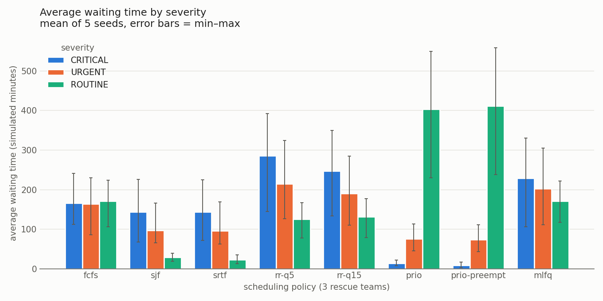
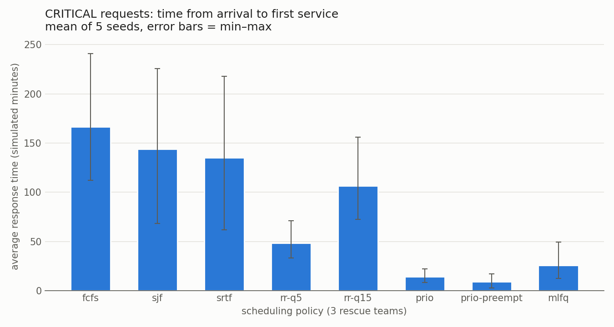
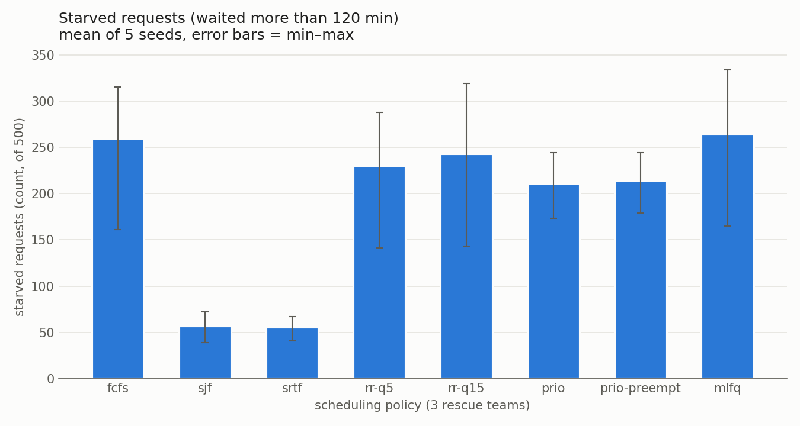
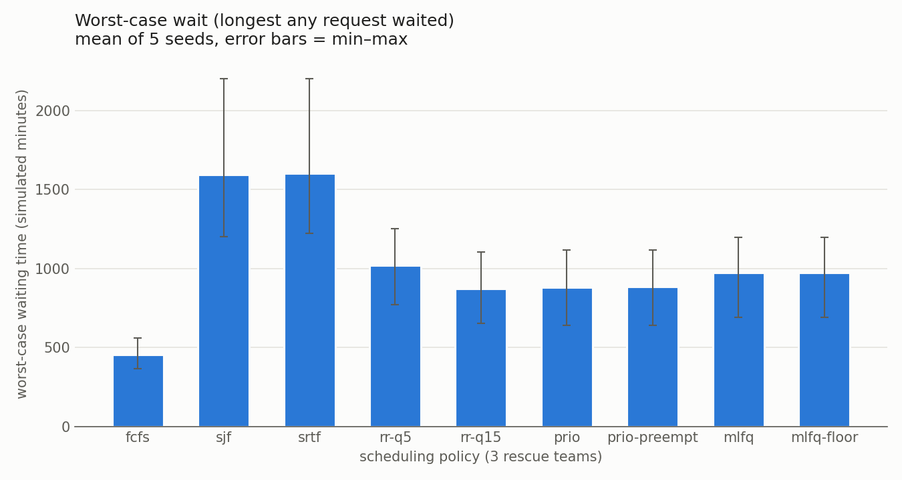

### What the data shows
- **Priority protects CRITICAL almost completely.** CRITICAL requests wait 9–14 min on average, and only
  1 of 375 (over the 5 seeds) starves: one request in seed 4 waited 126 min, just over the 120-min
  threshold. ROUTINE pays for it: 404–412 min average wait, and 57–75% of ROUTINE requests starve.
- **SJF/SRTF have the best averages and the fewest starved requests** (about 56), because most requests
  are short ROUTINE kits. But they ignore severity (CRITICAL waits about 144 min) and have the worst
  worst-case wait (about 1,600 min, a long rescue postponed again and again).
- **MLFQ moves starvation around instead of removing it.** It improves ROUTINE (172 vs 404 min under prio)
  at the expense of CRITICAL (229 vs 14 min), and its mean starved count, 264, is the highest of any policy
  (FCFS, at 260, is within its range).
  Two mechanisms explain it, both visible in seed 1:
  - **Aging floods the top queue.** There were 814 promotions, 620 of them Q1 → Q0. The rush backlog lasts
    far longer than the 60-minute aging threshold, so most URGENT and ROUTINE requests climb into Q0 and
    compete with CRITICAL ones as equals.
  - **Long critical rescues get demoted.** Rescues take 15–45 min but Q0's quantum is 8 min, so they sink
    to lower queues partway through. CRITICAL requests still *start* quickly (response 25.6 min) but then
    wait a long time to finish: 195 of 375 CRITICAL requests (52%, all seeds) starved under MLFQ, versus 1
    under priority.

### Conclusion
The hypothesis is **not supported**. MLFQ with aging does not match Priority on critical response time
(25.6 vs 9.0–14.3 min), and it does not bring starvation to zero: its mean of 264 starved requests is the
highest of all policies.
The cause is the setup, not a bug. With a rush backlog far longer than the 60-minute aging threshold,
aging promotes almost everything into Q0, and the 8-minute Q0 quantum demotes long CRITICAL rescues.
That erases the priority MLFQ starts with. Aging bounds how long one job can be overtaken; it cannot
make waits short when demand exceeds capacity. E2 should test a longer aging threshold, never demoting
CRITICAL work, and more teams.

`mlfq-floor` (added after the trace investigation below: CRITICAL work is never demoted below Q1)
changes almost nothing here: CRITICAL wait 219.5 vs 229.0 min, starved 261 vs 264, the rest within
noise. The floor only acts on a CRITICAL job's second demotion (Q1 → Q2), and the trace shows that
long CRITICAL jobs rarely get there: aging lifts them back to Q0 first.

## E1b: load sweep
**Question:** E1 ran at about 90% load. At what load does MLFQ stop reaching zero starvation, and how
do `prio-preempt`, `mlfq` and `mlfq-floor` degrade as the load rises?

**Setup** (`experiments/run_e1.sh`, part of `make e1`):
- Same seed family as E1 (seeds 1–5, 500 requests, 3 teams, starvation = wait > 120 min).
- For each seed the generator produces the *same* 500 requests at every load. Its random draws do not
  depend on `--duration`, and the script checks that the total work W is unchanged. Only the duration
  changes: D = W / (3 × load), for loads of 30, 45, 60, 75, 90 and 105%.
- **Arrival profile:** the generator's default (rate 3× higher in the middle third, so the peak runs
  at 1.8× the average load), **not** E1's 10× rush hour. A first run with the rush hour found no
  threshold. The rush window overloads 3 teams at *any* average load: at 30%, MLFQ still starved
  7.2 requests on average (prio-preempt 12.0). With the rush window scaled with D, the figure was 74.
- Results: `experiments/results/e1b.csv` (one row per policy, load and seed, with `target_load` and
  `offered_load` columns in front of the usual summary).

| Load | prio-preempt starved | mlfq starved | mlfq-floor starved | prio-preempt CRIT response | mlfq CRIT response | mlfq-floor CRIT response |
|-----:|------------------:|----------:|----------------:|-----:|-----:|-----:|
| 30% | 0 (max 0) | **0** (max 0) | 0 (max 0) | 0.0 | 0.0 | 0.0 |
| 45% | 19.4 (max 59) | 11.4 (max 30) | 10.6 (max 27) | 0.1 | 0.0 | 0.0 |
| 60% | 125.2 (max 169) | 134.2 (max 271) | 134.2 (max 263) | 0.2 | 5.9 | 5.9 |
| 75% | 182.6 (max 204) | 263.6 (max 348) | 261.0 (max 349) | 0.3 | 32.8 | 32.6 |
| 90% | 252.0 (max 311) | 343.0 (max 388) | 341.6 (max 394) | 0.5 | 66.6 | 66.6 |
| 105% | 289.0 (max 330) | 363.8 (max 390) | 363.0 (max 394) | 0.9 | 95.5 | 95.3 |

Starved counts are means over 5 seeds (out of 500 requests). Response times are CRITICAL averages in
simulated minutes. At 45%, MLFQ starved requests in 4 of 5 seeds (seed 2: 0).

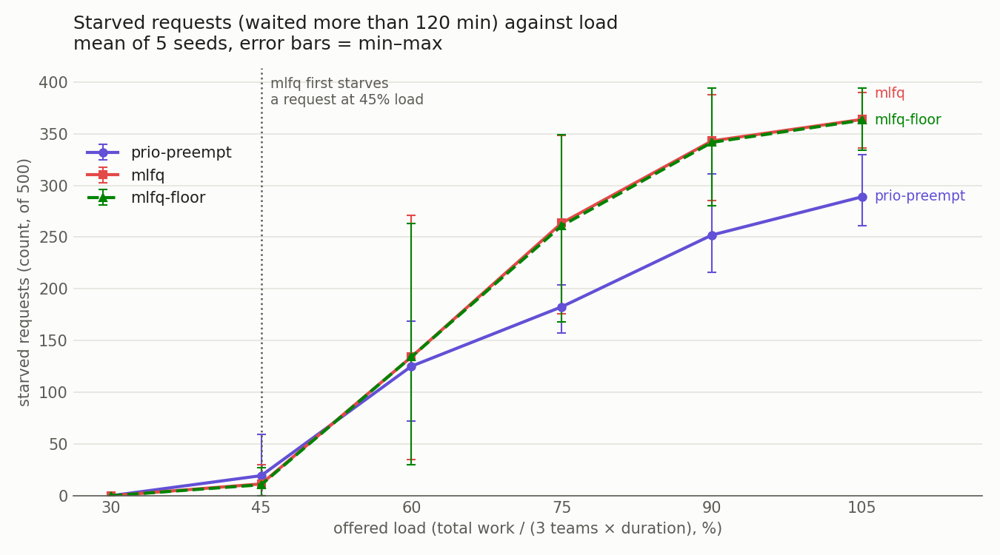
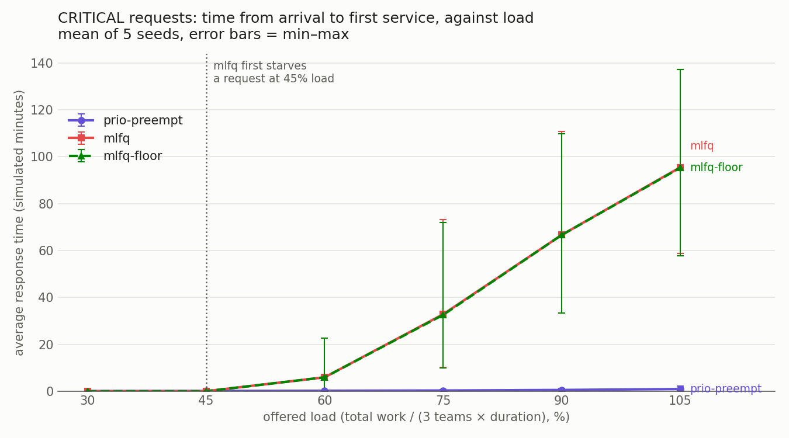

**Conclusion:**
1. MLFQ reaches zero starvation only at 30% offered load. **At 45% it starts starving requests**
   (11 on average, up to 30), because the 1.8× mid-run peak already exceeds capacity there.
2. Above 60%, MLFQ starves more than prio-preempt (264 vs 183 at 75%). Its CRITICAL response grows from 0 to
   95 min, while prio-preempt keeps CRITICAL under 1 min at every load. MLFQ's advantage disappears
   once aging promotes the backlog into Q0.
3. `mlfq-floor` tracks `mlfq` within noise at every load, so the severity floor does not change
   MLFQ's behaviour under load. Only admission control or more teams would, not a different queue
   discipline.

## E2: real Linux scheduling vs textbook priority

**Question:** E1 compared *simulated* policies. How does the real Linux scheduler treat the same kind of
workload, and how close do textbook priority scheduling and our MLFQ come to it?

### Kernel
`uname -r` gives `6.18.33.2-microsoft-standard-WSL2`. Since Linux 6.6, the normal scheduling class
(`SCHED_OTHER`, still called the "fair" class) chooses tasks with **EEVDF** (Earliest Eligible Virtual
Deadline First), which replaced CFS's leftmost-vruntime pick. **This kernel therefore uses EEVDF.** nice still
maps to the same weights (nice 0 = 1024, about ×1.25 per step), so "CFS" below means the fair class as
implemented by EEVDF. The machine has 16 CPUs. Real-time throttling is on (`sched_rt_runtime_us` =
950000: real-time tasks may use at most 95% of each second), and `sched_rr_timeslice_ms` is 100.

### Setup
- **Workload:** `gen_scenario.py --rows 120 --seed 1 --duration 2000 --rush 60-120`. That is about 1,800
  simulated minutes of work in 2,000 minutes, so **~90% load on one CPU**, with a rush-hour backlog.
- **`build/linuxsched`:** one real thread per request, created at its arrival time (1 simulated minute =
  4 ms). Each thread burns `burst × 4 ms` of its own CPU time (`CLOCK_THREAD_CPUTIME_ID`, so waiting
  doesn't count as work), 7.2 s of CPU in total.
- **Pinning:** the process is pinned to **one CPU** with `sched_setaffinity`. On 16 CPUs the threads
  would mostly run in parallel and the scheduler would rarely have to choose.
- **Recording:** every thread records its start (first instruction), finish and CPU time. Response =
  start − arrival; wait = turnaround − CPU time. Both are converted back to simulated minutes.
- **Linux modes:**

  | Mode | Class | CRITICAL / URGENT / ROUTINE |
  |------|-------|-----------------------------|
  | `cfs-flat` | `SCHED_OTHER` | nice 0 / 0 / 0 |
  | `cfs-nice` | `SCHED_OTHER` | nice −5 / 0 / +5, via `setpriority()` on each thread's TID (nice is per-thread on Linux) |
  | `fifo` | `SCHED_FIFO` | real-time priority 30 / 20 / 10 |
  | `rr` | `SCHED_RR` | real-time priority 30 / 20 / 10 |

  FIFO/RR and negative nice need `CAP_SYS_NICE`, granted once with
  `sudo setcap cap_sys_nice+ep build/linuxsched`. Without it, `cfs-nice` falls back to 0 / +5 / +10
  (same spacing, same CPU shares) and FIFO/RR are skipped.
- **Thread creation:** with the capability, the thread that creates the workers runs at `SCHED_FIFO` 40,
  above every worker, so arrivals stay on time (creation lag ≤ 0.83 ms here).
- **Simulated counterparts:** `schedsim --teams 1` on the same scenario: `prio`, `prio` preemptive, and
  `mlfq` with age 60. E1's numbers are not reused here, because E1 used 3 teams on a different load.
- **Safety:**
  - A watchdog thread at the highest `SCHED_FIFO` priority aborts any run after 30 s, so a FIFO bug
    cannot freeze WSL.
  - Scenarios needing more than 10 s of CPU are refused.
  - `tests/linuxsched.sh` checks the pinning, the CPU-time budget, the nice spacing, the budget refusal,
    and that the watchdog really aborts a runaway run.
- **Reproduce:** `make e2` (or `experiments/run_e2.sh` then `experiments/plot_e2.py`). Every rebuild of
  `linuxsched` drops the capability, so rerun `setcap` after `make`.

### Results
Simulated minutes; a single run of each mode, all four in the same privileged run. Linux timings vary a
little between runs (`cfs-flat` CRITICAL wait: 235, 237 and 251 in three runs).

| Variant | Response CRIT | Response URG | Response ROUT | Wait CRIT | Wait URG | Wait ROUT |
|---------|-------------:|------------:|-------------:|---------:|--------:|---------:|
| Linux `cfs-flat` | 3.0 | 3.5 | 2.9 | 250.9 | 142.7 | 83.6 |
| Linux `cfs-nice` | 2.0 | 1.2 | 1.4 | 128.8 | 149.6 | 201.2 |
| Linux `fifo` | **0.0** | 64.8 | 198.3 | **23.4** | 93.0 | 210.4 |
| Linux `rr` | **0.0** | 65.6 | 195.8 | 31.7 | 97.9 | 209.9 |
| sim `prio` | 35.5 | 94.4 | 240.0 | 35.5 | 94.4 | 240.0 |
| sim `prio` preemptive | 27.3 | 88.9 | 240.0 | 27.3 | 96.4 | 247.6 |
| sim `mlfq` | 16.1 | 51.1 | 99.5 | 184.2 | 122.6 | 129.2 |

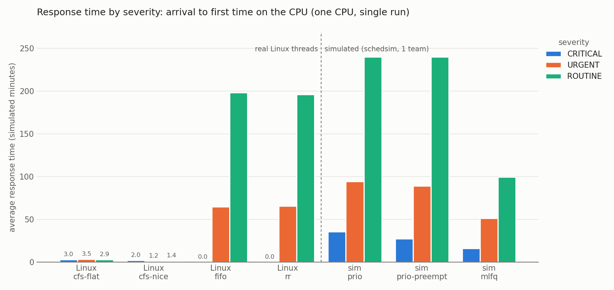
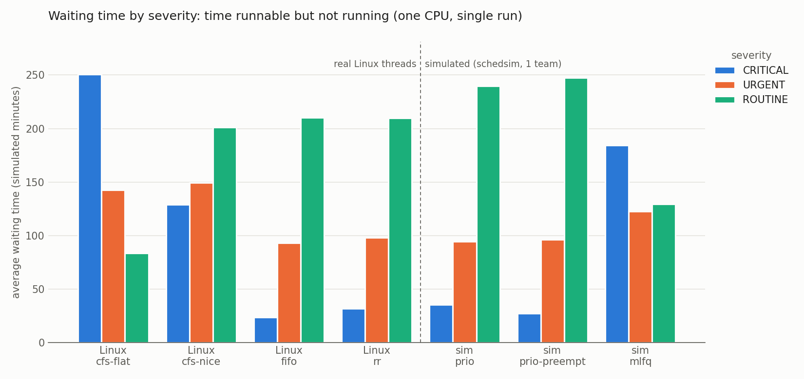

### How CFS/EEVDF and nice differ from textbook priority
- **Textbook priority is strict:** a higher-priority job always runs first, and lower ones wait
  (possibly forever). **The fair class is proportional:** every runnable thread gets CPU in proportion
  to its weight, and none is starved.
- **Every fair-class thread starts within a few milliseconds**, 1–3.5 simulated minutes (4–14 ms), whatever
  its nice value. A new thread waits for EEVDF to reach its virtual deadline, which takes a few slices,
  but never for a whole higher-priority job. nice barely affects *when* a thread first runs.
- **nice changes the share, so it shows up in the wait.**
  - With nice 0 for everyone (`cfs-flat`), the CPU is shared equally. Long jobs then finish last, so
    CRITICAL rescues (15–45 min of work) wait the *longest* (251 min) and short ROUTINE kits the shortest (84).
  - With nice −5 / 0 / +5, the weights are 3121 / 1024 / 335, so a CRITICAL thread gets about 9× the share
    of a ROUTINE one. That halves the CRITICAL wait (251 → 129) and more than doubles the ROUTINE wait
    (84 → 201).
  - It is still far from strict priority (CRITICAL waits 23–36 min), because ROUTINE threads keep
    getting their share.
- **Method note:** in an earlier run without the capability, the creating thread was itself an ordinary
  fair-class thread. There the fair modes showed responses of only 0.1–0.5 simulated minutes, because
  waking the creator tended to hand the CPU straight to the newly created thread. The wait results
  were the same within noise (CRITICAL 237 / 120). How a thread is created changes its first-run latency
  under EEVDF, which is why all four modes above use the same privileged creator.

### What SCHED_FIFO does to low priorities
- **CRITICAL threads (priority 30) run the instant they arrive** (response 0.0) and are never preempted by
  lower priorities, so their wait (23.4) is the lowest of every variant.
- **Lower priorities run only when no higher real-time thread is runnable.** URGENT threads wait on
  average 65 simulated minutes before their *first* instruction (409 at worst), ROUTINE threads 198 (900 at
  worst): 23 of 60 ROUTINE threads waited over 2 simulated hours just to start. Under a longer stream of
  CRITICAL work they would never run at all, which is classic starvation. RT throttling (95%) reserves
  time only for *non-real-time* tasks, not for lower real-time priorities.
- **SCHED_RR is almost the same,** because its 100 ms time slice (25 simulated minutes) only rotates
  threads of *equal* priority. That rotation is visible in one place: CRITICAL wait rises from 23.4 to 31.7
  when long CRITICAL rescues take turns instead of running to completion.
- **Our simulator predicts this:** Linux `fifo` (23 / 93 / 210) matches sim `prio` preemptive
  (27 / 96 / 248) closely. The simulation preempts only at minute boundaries, and Linux preempts
  immediately, which is why Linux is slightly better for CRITICAL.

### How close our MLFQ gets
- **Response:** MLFQ gives a much better response than textbook priority for URGENT and ROUTINE
  (51 / 100 vs 89–94 / 240), and starts CRITICAL work within 16 min. It is nowhere near Linux FIFO for
  CRITICAL (0) or the fair class for everyone (1–3.5).
- **Wait:** MLFQ's pattern resembles `cfs-flat`, not priority: CRITICAL waits longest (184 vs 251 in
  `cfs-flat`), while URGENT and ROUTINE are close (123 / 129 vs 143 / 84). At 90% load, aging and demotion
  turn MLFQ into something close to fair sharing, which is the same effect E1 found.
- **Overall:** Linux offers both extremes. FIFO is strict priority (best for CRITICAL, starves the rest);
  the fair class with nice is proportional share (nobody starves, CRITICAL still waits two hours). Our
  MLFQ sits between them but closer to fair sharing.
- **For relief triage:** run life-critical work as real-time FIFO, cap it so it cannot monopolise the
  CPU (which RT throttling only partly does), and give the rest weighted fair sharing. That is the
  design Linux itself uses.

### Why simulated MLFQ makes CRITICAL wait longest (trace investigation)
In the table above, simulated MLFQ gives CRITICAL a *higher* average wait (184) than URGENT
(123) or ROUTINE (129), even though CRITICAL enters at the top queue.

**How it was traced.** `schedsim --trace FILE` writes every arrive, dispatch, preempt, demote,
promote and finish event with the job's queue level. `experiments/analyze_mlfq_trace.py` replays the
trace and checks the MLFQ rules on every event:
- a job enters at its severity level;
- a demotion comes exactly one full quantum after the dispatch (Q0 8, Q1 16) and moves one level down;
- a promotion only happens to a waiting job, after more than `--age` minutes at that level, and moves
  one level up;
- the waiting time rebuilt from the events equals finish − arrival − burst.

To reproduce:
```sh
python3 experiments/gen_scenario.py --rows 120 --seed 1 --duration 2000 --rush 60-120 -o /tmp/e2.csv  # E2 scenario
build/schedsim --policy mlfq --age 60 --teams 1 --seed 1 --scenario /tmp/e2.csv --trace /tmp/mlfq_trace.csv
python3 experiments/analyze_mlfq_trace.py /tmp/mlfq_trace.csv --show 3
```
The trace reproduces E2's numbers exactly, and **every invariant holds for all 120 jobs**.

**Verdict: not a bug. It is a real effect of demotion plus aging.** Waiting time per queue level,
averaged per severity:

| Severity | Burst | Wait in Q0 | Wait in Q1 | Wait in Q2 | Total wait | Demotions | Promotions |
|----------|------:|-----------:|-----------:|-----------:|-----------:|----------:|-----------:|
| CRITICAL | 26.4 | 87.1 | 93.7 | 3.4 | 184.2 | 1.94 | 1.39 |
| URGENT | 17.6 | 46.0 | 65.1 | 11.5 | 122.6 | 0.62 | 0.83 |
| ROUTINE | 9.8 | 38.7 | 39.4 | 51.2 | 129.2 | 0.20 | 1.15 |

Average wait by burst length (number of jobs in brackets):

| Burst | CRITICAL | URGENT | ROUTINE |
|-------|---------:|-------:|--------:|
| 1–10 | 28.0 (5) | 100.3 (11) | 102.3 (44) |
| 11–20 | 53.2 (4) | 111.1 (18) | 215.9 (11) |
| 21–40 | 44.7 (3) | 163.8 (12) | 320.5 (2) |
| > 40 | **471.3 (6)** | 82.0 (1) | 78.7 (3) |

- **Short CRITICAL jobs do well:** 28–53 min, the best of any severity. The high average comes from
  6 long rescues (burst > 40) that wait 471 min each.
- **The mechanism is a Q0 ↔ Q1 ping-pong.**
  1. A long CRITICAL job runs its 8-minute Q0 quantum and is demoted to Q1.
  2. At 90% load, Q1 is not served for over an hour, because Q0 always has work.
  3. After 61 minutes of waiting, aging promotes the job back to Q0.
  4. It gets another 8 minutes, and the cycle repeats.

  The job never receives Q1's 16-minute slice, and it pays the aging delay once per 8 minutes of
  service. Job 6000033 (burst 57) went through 6 demotions and 5 promotions and waited 619 min:
  261 in Q0 and 358 in Q1.
- **Long ROUTINE jobs escape this.** They start in Q2 (FCFS, no quantum), so once Q2 runs one, it
  finishes. URGENT jobs fall between the two.
- MLFQ is built to favour short jobs, so this is MLFQ doing what it was designed to do. Severity only
  sets the entry queue, and burst length decides everything after that.

**The `mlfq-floor` variant** (`--policy mlfq-floor`; `--crit-floor Q` sets the floor, default Q1)
never demotes CRITICAL work below Q1. When a floored job uses up its quantum, it is put back behind
the jobs waiting at its level or above, but not demoted further. On this scenario the floor barely helps:
CRITICAL wait goes from 184.2 to 182.5, with 48 starved requests in both. The ping-pong happens
between Q0 and Q1, above the floor.

A diagnostic run with a floor at Q0 (`--crit-floor 0`, so CRITICAL work is never demoted) removes the
inversion: CRITICAL 134.3, URGENT 151.0, ROUTINE 142.6. But the starved count rises to 51, so it moves
the wait onto everyone else. That turns MLFQ back into priority scheduling with round robin inside
Q0, so it was not added to E1.

## E3: deadlock handling compared
**Question:** On the same vehicle-heavy workload, what does each way of dealing with deadlock cost?
The options are doing nothing, preventing (resource ordering or all-or-nothing), avoiding (Banker's),
or detecting and recovering.

### Setup
- **Simulator:** `make e3` (`experiments/run_e3.sh`) runs **`build/dlsim`**. It is a deterministic,
  one-minute-clock simulator of reliefd + camps. It uses the same policy code (`src/deadlock/`) and
  the same camp rules: claims, tasks acquired one row after another, retry in order after an order
  rejection, bundles, revoke and requeue. It has no threads or IPC, so a run is a pure function of
  the scenario, and two runs give byte-identical CSVs.
- **Workload:** 5 seeds of a **300-request task mix** (`gen_deadlock.py --rows 300 --camps 8
  --duration 1200`):
  - 89% vehicles: 267 truck/boat rows and 33 kit rows on seed 1;
  - tasks of 2–3 resources, with trucks and boats requested in random orders;
  - the default 3 trucks and 2 boats, so demand is well above capacity.

  Also `scenarios/deadlock.csv` (2 camps, 2 trucks, 2 boats).
- **Modes:**
  - `none`;
  - `prevent` (per-task resource ordering);
  - `prevent --all-or-nothing`;
  - `avoid`;
  - `detect`, checking every 5 minutes and recovering by preempting a vehicle.
- **Metrics:**
  - **deadlocks reached:** new deadlocks found by the detection algorithm run every minute over
    *jobs*, meaning tasks and lone rows, the units that hold and wait;
  - **delay:** request due → granted, for completed requests;
  - **vehicle time:** split three ways: *busy* (held by a complete task or a lone row, doing the
    work), *held idle* (held by a task still waiting for its next row) and *free*.

### Results (300-request mix, mean of 5 seeds)
| Mode | Completed (of 300) | Deadlocks reached | Requests/hour | Avg delay (min) | Max delay | Unsafe denials | Preemptions | Order rejects | Vehicles busy / held idle / free |
|------|------:|------:|------:|------:|------:|------:|------:|------:|:------:|
| `none` | **36.8** (14–61), frozen 5/5 | 1.6 | 1.8 | 19.7* | 102 | – | – | – | 11% / **86%** / 3% |
| `prevent` (ordering) | 300 | 0 | **13.2** | 93.2 | 328 | – | – | 75.0 | 77% / 19% / 3% |
| `prevent --all-or-nothing` | 300 | 0 | **13.3** | 92.9 | 292 | – | – | – | 78% / 0% / **22%** |
| `avoid` (Banker's) | 300 | 0 | 11.7 | 191.0 | 675 | 69.2 | – | – | 68% / 11% / 20% |
| `detect` (+ recovery) | 300 | **186.6** | 5.3 | **1227.9** | 3244 | – | **572.0** | – | 36% / **62%** / 1% |

\* Only the requests that completed before the freeze: the other ~263 wait forever.

On `deadlock.csv`:
- `none` freezes at minute 10 with 0 of 6 done: one deadlock, the circular wait camp 1 ↔ camp 2.
- Every other mode finishes all 6 in 70 minutes:
  - `prevent`: 2 order rejections;
  - `avoid`: 1 unsafe denial;
  - `detect`: 1 preemption;
  - all-or-nothing: the longest average delay, 21 min vs 11–13.

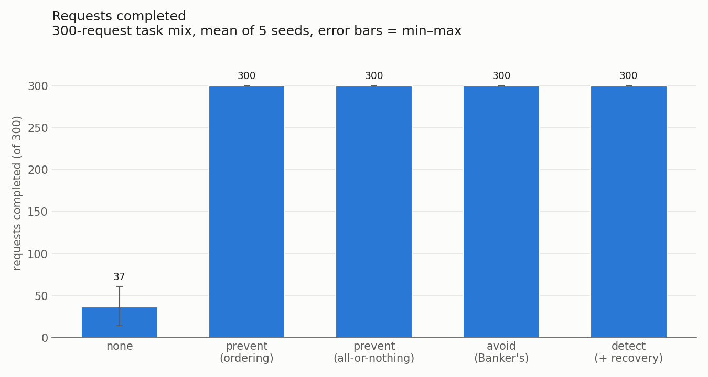
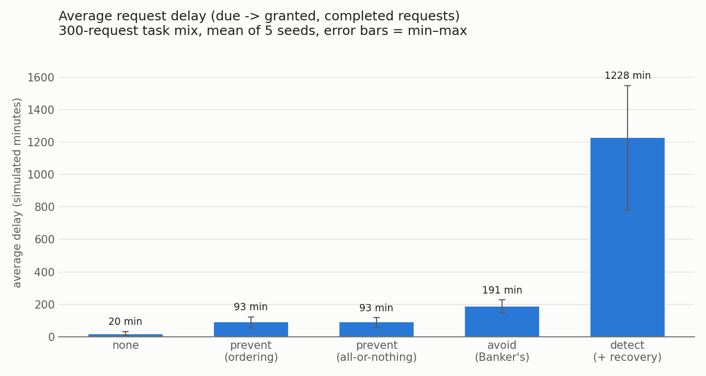
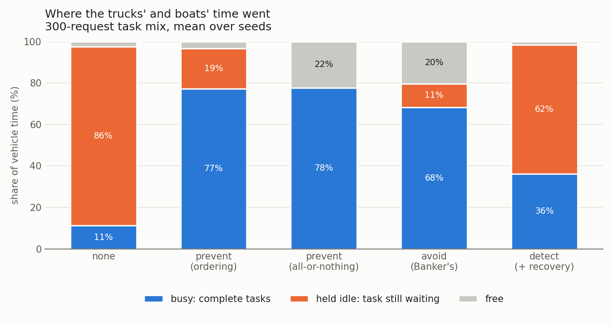
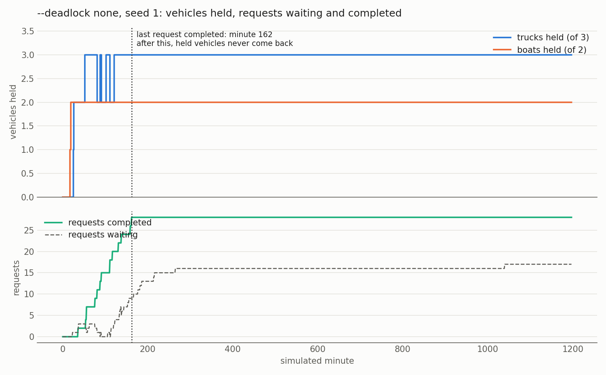

### What the data shows
- **Doing nothing deadlocks, and the deadlock spreads.**
  - In seed 1 the last request completes at minute 162. After that, 3 trucks and 2 boats are held
    forever by tasks that each wait for a vehicle another of them holds.
  - Every later request waits behind them, so 86% of all vehicle time is "held idle" and only 37
    of 300 requests complete.
  - One cycle takes away the whole fleet, not only the vehicles of the camps on the cycle.
- **Prevention works but wastes capacity, in two different ways.**
  - **Ordering** (circular wait broken) rejected 75 out-of-order requests per run. Each rejected
    task released what it held and started again. While a task waits for its next, higher-ordered
    resource, it still holds the lower ones: 19% of vehicle time held idle.
  - **All-or-nothing** (hold and wait broken) never holds a vehicle idle (0%), but 22% of vehicle
    time is *free*: a waiting bundle needs a truck and a boat together, so a truck that is free
    on its own stays unused.
  - Both finish in about the same time (13.2–13.3 requests/hour, the best of all modes).
- **Avoidance needs the maximum claims in advance and is cautious.**
  - Every camp must declare its peak demand up front, and the Banker's algorithm refuses 69
    requests per run that were available but unsafe.
  - The result is the longest delays of the modes that never deadlock: 191 min on average, 675 at
    worst. Requests/hour is 11.7, and 20% of vehicle time is free because it was kept back for
    safety.
  - It never deadlocks and never wastes work, but it trades throughput for that certainty, and
    it only works because each camp knows its future demand.
- **Detection lets deadlocks happen and pays for recovery.**
  - It completes everything, but deadlocks keep reforming: 187 per run, and 572 preemptions, about
    3 per deadlock. Recovery takes back *one* vehicle from the victim, and the victim keeps the rest
    of its task and keeps waiting, so the same group of tasks soon deadlocks again.
  - Between detections (every 5 minutes) the deadlocked vehicles sit idle: 62% of vehicle time is
    held idle. Delays average 1,228 minutes, and throughput (5.3 requests/hour) is less than half
    that of prevention.
  - Rolling back the victim's whole task, instead of one vehicle, would break the pattern faster.
    reliefd and dlsim implement the single-vehicle preemption asked for in Phase 3 step 4.

### Conclusion
| Approach | What it costs | When to use it |
|----------|---------------|----------------|
| `none` | One circular wait freezes the whole fleet | Never, when vehicles are scarce |
| Prevention | Utilisation: idle-held vehicles (ordering, 19%) or idle free vehicles (all-or-nothing, 22%); also retries (ordering) | Simple, no knowledge of future demand; the best throughput here |
| Avoidance | Maximum claims must be known in advance; cautious refusals cost delay (191 min average) and leave 20% of capacity free | Demand is predictable (planned relief convoys) |
| Detection + recovery | Deadlocks happen; every recovery wastes work and the victim can deadlock again (572 preemptions, 1,228 min average delay) | Deadlocks are rare (light load), or preempting is cheap |

For ReliefOS's vehicle-heavy overload, **prevention** is the best trade-off, either variant. It never
deadlocks, needs no claims, and keeps throughput highest. Its waste of capacity (about a fifth of
vehicle time) is the price.

## E4: the critical-section problem (two camps, one boat)
**Question:** Two camps share one boat, and both update the shared inventory counter. Which ways of
protecting that update keep the count correct, and what does each one cost? When does a Linux
mutex actually enter the kernel?

### Setup
`build/racelab --mode M --iters N` (`src/racelab/main.c`) starts 2 threads. A barrier makes them begin
together. Each thread does N = 1,000,000 increments of one shared `volatile long`, as a separate read,
modify and write, inside the entry and exit sections of mode M:

| Mode | Entry / exit section |
|------|----------------------|
| `none` | nothing |
| `peterson-nofence` | textbook Peterson: `flag[i] = 1; turn = j; while (flag[j] && turn == j);` on plain volatile ints |
| `peterson` | the same algorithm with `atomic_thread_fence(memory_order_seq_cst)` after the two stores (MFENCE on x86) |
| `spinlock` | our test-and-set lock: `while (atomic_flag_test_and_set(&f)) pause;` (XCHG on x86) |
| `mutex` | `pthread_mutex_lock` / `unlock` |
| `semaphore` | POSIX unnamed semaphore, `sem_init(&s, 0, 1)`: `sem_wait` = P, `sem_post` = V |

- **Runs:** `experiments/run_e4.sh` (`make e4`) runs every mode 10 times, interleaved, and writes one row
  per run to `experiments/results/e4.csv`. Machine: WSL2, kernel 6.18, 16 CPUs, so the two threads run
  truly in parallel.
- **Expected count:** 2N = 2,000,000. Error = 2N − final, the number of lost updates.
- **Determinism:** none here. The racy counts, all runtimes and the futex counts are real measurements
  and change from run to run.

### Results
| Mode | Lost updates, mean (min–max) | Runs that lost updates | Runtime, ms, mean (min–max) | ns per increment |
|------|-----------------------------:|-----------------------:|----------------------------:|-----------------:|
| `none` | 896,307 (852,297–977,276) | 10/10 | 16.9 (16.3–17.4) | 8.4 |
| `peterson-nofence` | 34.8 (8–93) | **10/10** | 100.8 (57.8–110.5) | 50.4 |
| `peterson` | 0 | 0/10 | 76.5 (73.9–79.7) | 38.3 |
| `spinlock` | 0 | 0/10 | 32.6 (25.8–41.5) | 16.3 |
| `mutex` | 0 | 0/10 | 42.7 (37.9–45.2) | 21.4 |
| `semaphore` | 0 | 0/10 | 111.6 (101.3–123.1) | 55.8 |

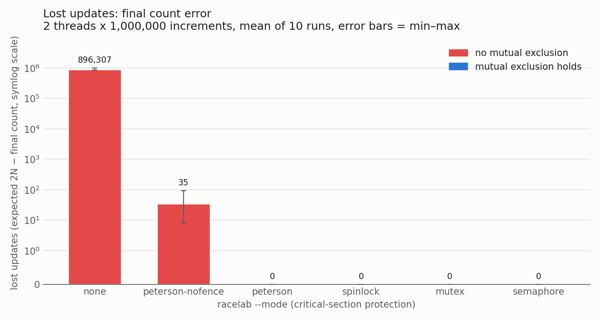
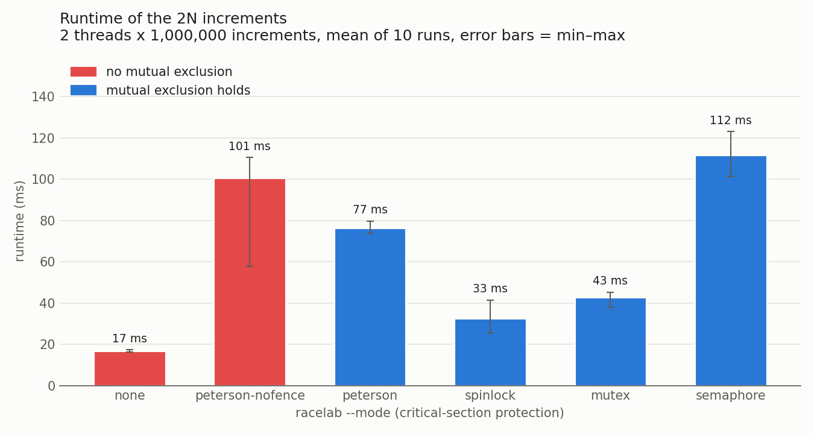

### What the data shows
- **No protection loses about 45% of the updates,** and the final count is different every run
  (between 1.02 and 1.15 million instead of 2 million). Both threads load the same value, both add 1,
  and both store it, so one increment disappears. The race window is the whole read-modify-write.
- **The textbook Peterson fails on x86 in every run, but only rarely within a run:** it lost 8–93 of
  2,000,000 updates (an earlier check: 20 failing runs out of 20). Peterson's proof assumes sequential
  consistency. x86 is TSO, which keeps every ordering *except* store → load. Each core holds its
  stores in a private store buffer and lets later loads overtake them. So thread 0 can still be
  holding `flag[0] = 1` in its buffer while it reads `flag[1]` from memory as 0. Thread 1 does the
  same, and both enter. The variables are `volatile`, so this is the hardware, not the compiler.
  Textbooks assume sequential consistency because it makes the algorithm provable on paper; CPUs
  give it up for speed. The fenced `peterson` drains the store buffer before the loads and lost
  nothing in 10 runs (and in 20 extra runs). ThreadSanitizer also passes it, because its flags are C11 atomics.
- **The fence is not what makes Peterson slow.** `peterson` (77 ms) is faster than the unfenced version
  (101 ms), and both are about 2× slower than the spinlock or mutex. The likely cause, which we did not
  measure, is that Peterson hands the turn to the other camp whenever both want in. Under constant
  contention that becomes near-strict alternation, so the counter and flag cache lines move between
  cores on almost every increment. The spinlock and mutex are not fair: the thread that just unlocked
  usually relocks at once while the line is still in its cache.
- **Spinlock vs mutex:** they are about the same here (33 vs 43 ms). The critical section is a few
  nanoseconds, so a spinning waiter gets the lock almost immediately. A spinlock wastes a whole CPU
  while it waits, so it only pays off for very short sections on a multiprocessor. With one CPU, or a
  long section, the mutex wins because its waiter sleeps.
- **The semaphore is the slowest correct mode** (112 ms). It does the same job as the mutex but goes
  through glibc's general counting-semaphore code and made more futex calls under contention (450 vs
  348). We did not profile further.

### How a Linux mutex becomes a futex (strace)
`run_e4.sh` also runs `strace -f -e trace=futex -c` on each primitive. The full output is in
[`docs/strace_futex.txt`](strace_futex.txt):

| Run | Lock operations | futex system calls |
|-----|----------------:|-------------------:|
| `mutex`, 2 threads (contended) | 2,000,000 | 348 (113 returned EAGAIN) |
| `mutex`, 1 thread (uncontended) | 1,000,000 | 3 |
| `semaphore`, 2 threads | 2,000,000 | 450 (169 EAGAIN) |
| `semaphore`, 1 thread | 1,000,000 | 3 |
| `spinlock`, 2 threads | 2,000,000 | 4 |

- **The 3–4 calls in every run are bookkeeping,** not locking: the start barrier, and `pthread_join`
  waiting for the kernel's futex wake when a thread exits.
- **Without contention, a pthread mutex never enters the kernel.** `pthread_mutex_lock` is one atomic
  compare-and-swap on a word in user space. The futex ("fast userspace mutex") system call is made
  only when that CAS finds the lock taken: `FUTEX_WAIT` puts the thread to sleep in the kernel, and the
  unlocker sees the waiter bit and calls `FUTEX_WAKE`. EAGAIN means the lock word changed between the
  failed CAS and the `FUTEX_WAIT`, so the kernel returned at once instead of sleeping.
- **Even under full contention,** only about 1 lock operation in 5,700 needed the kernel (348 of
  2,000,000). The semaphore is built the same way.
- **The spinlock never makes a system call:** it waits by spinning on the CPU instead.
- strace stops the traced thread on every futex call, which changes the timing and therefore the
  amount of contention. Treat these counts as orders of magnitude.

### Conclusion
- Unprotected sharing is wrong almost half the time.
- A correct textbook algorithm (Peterson) is wrong on real hardware unless a memory fence restores the
  sequential consistency it assumes.
- The Linux primitives (futex-based mutex and semaphore) and a test-and-set spinlock are all correct.
  The mutex costs about 21 ns per increment here, and it only enters the kernel when there is a waiter.

## E4b: readers–writers, writer starvation
**Question:** The inventory is read by many threads and written rarely. Does the textbook
readers-preference solution (semaphores `mutex` and `rw_mutex`, plus `read_count`) starve the
writer? Does glibc's writer-preference rwlock fix that, and what does it cost the readers?

**Setup:** `make e4b` (`experiments/run_e4b.sh`) runs `build/rwlab --rw semaphore|rwlock`:
- 8 reader threads each hold the read lock for 100 µs, reading the whole inventory table, and
  re-enter at once.
- 1 writer thread updates the table (20 µs under the write lock) every 2 ms.
- Each run lasts 2 s; 5 runs per kind, interleaved, on 16 CPUs (WSL2, kernel 6.18).
- Every lock acquisition is timed, and every read checks that the table is not half-written.
- Results go to `experiments/results/e4b.csv`. The numbers are real timings and vary between runs.

| Lock (`--rw`) | Writes during the 2 s (mean per run) | Writer wait, mean | Writer wait, max | Reads per run | Reader wait, max | Torn reads |
|---------------|------:|------:|------:|------:|------:|---:|
| `semaphore` (readers preference) | **0** | 1,999 ms | 2,000 ms | 158,989 | 0.12 ms | 0 |
| `rwlock` (writer preference) | 901 | 0.12 ms | 0.20 ms | 150,148 | 0.28 ms | 0 |

**Conclusion:**
- **The semaphore version starves the writer completely:** 0 writes in every run. Its one write
  happens only when the readers stop, after waiting the whole run. With 8 readers overlapping,
  `read_count` never drops to 0, so `rw_mutex` is never released to the writer.
- **The writer-preference rwlock removes the starvation:** a waiting writer blocks new readers,
  so it waits only for the readers already inside (at most one 100 µs read).
- **The readers pay a little:** 5.6% fewer reads, and a worst-case reader wait of 0.28 ms instead
  of 0.12 ms.
- **reliefd's choice:** it uses `rwlock` by default (`--rw`), because a restock or a delivery must
  not wait behind an endless stream of status reads.

## E5: warehouse placement, memory allocation strategies
**Question:** On the same stream of relief shipments, how much space does each allocator waste,
and how often does it fail?

**Setup:** `make e5` (`experiments/run_e5.sh`) runs `build/memsim` (`src/mem/`):
- **Floor:** 1024 units.
- **Trace:** 2,000 operations per seed, seeds 1–5, the same for every allocator.
  - A shipment is 1–12 FOOD (4 units each), 1–16 MED (2) or 1–16 HYGIENE (1) kits.
  - Arrivals are likelier while the floor is under 90% full, so it runs close to full.
- **Fragmentation is sampled after every operation:**
  - *external* = 1 − largest free piece ÷ free space;
  - *internal* = wasted units ÷ units taken.
- **First/best/worst fit and buddy** place a shipment contiguously. **Slab** gives each kit an object in
  its kind's cache: slabs are 16-unit frames, holding 4 FOOD, 8 MED or 16 HYGIENE kits.
- **Results:** `experiments/results/e5.csv`.

| Allocator | External fragmentation | Internal fragmentation | Failed allocations | Failures with enough free space in total |
|-----------|------:|------:|------:|------:|
| first fit | 72.0% | 0% | 6.4% | 100% |
| best fit | 68.4% | 0% | **5.7%** | 100% |
| worst fit | 85.9% | 0% | 12.0% | 100% |
| buddy | 65.7% | 21.8% | 13.3% | 88% |
| slab | **0%** | 16.3% | **3.8%** | 0% |

Means over 5 seeds; the error bars in the figure show the min–max.

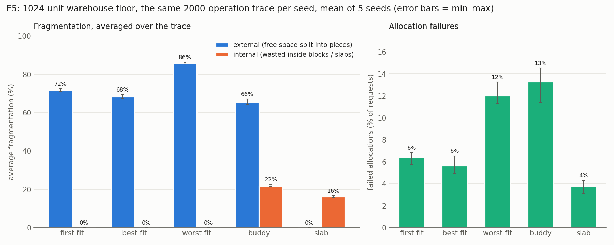

**Conclusion:**
- **Variable partitioning wastes nothing inside a partition, but its free space shatters.**
  Every failure of first, best and worst fit happened with enough free units in total, just not in
  one piece. Best fit fails least (5.7%); worst fit, which keeps carving up the biggest holes, fails
  twice as often (12.0%).
- **The buddy system trades external for internal fragmentation:** 22% of what it hands out is
  wasted inside power-of-two blocks. It fails most of all (13.3%), because rounding up fills the floor
  faster.
- **The slab caches fail least (3.8%), with no external fragmentation:** any free frame fits any kit.
  The cost is 16% of the slab space sitting in half-empty slabs. For pre-packed, fixed-size kits,
  slabs are the right warehouse layout.

## Baseline (Phase 2 step 2)
`schedsim --teams 3` on `scenarios/flood_pune.csv` (200 requests in 360 min, permanently overloaded). The
full table is in README.md under "Scheduling simulator". Key points: FCFS averages 402 min of waiting;
SJF/SRTF about 190; priority gives CRITICAL about 30 min but starves the rest; MLFQ with age 60 collapses
under this overload (CRITICAL 525 min, 522 promotions). E1 reproduces the MLFQ effect at 90% load.

## Workloads
Scenarios come from `experiments/gen_scenario.py`, which is seeded and deterministic: the same arguments
always produce a byte-identical CSV. Defaults: 200 rows, 8 camps, seed 2019, 360 simulated minutes,
mix 15/35/50 (CRITICAL/URGENT/ROUTINE, exact quotas). Arrivals follow a Poisson process with a 3x
flood peak in the middle third, or with `--rush START-END` a rush hour `--rush-factor` (default 10) times
denser than the rest. Flood-plain camps carry more load, and the resource, quantity and service time
depend on severity. Record the generator command line with every experiment.

For each experiment, record: hypothesis, setup (scenario, seed, policies), metrics,
CSV schema, the command to reproduce it, and the results and analysis.
